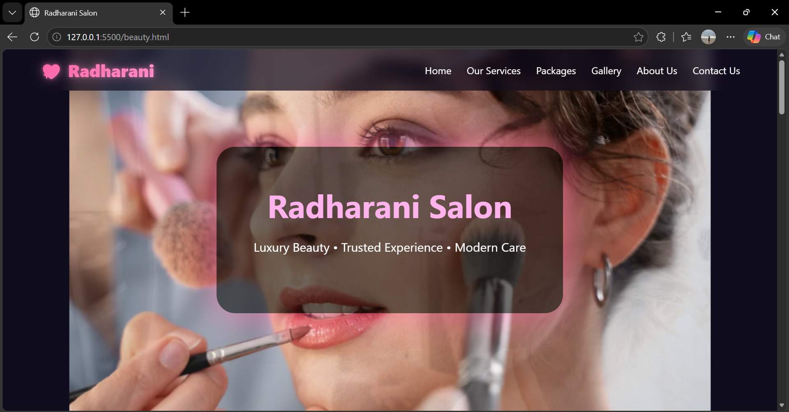
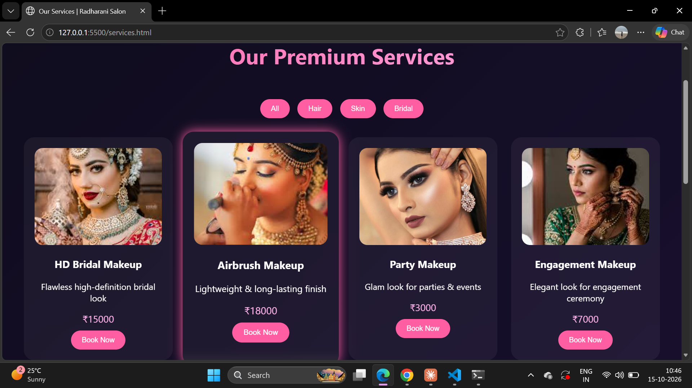
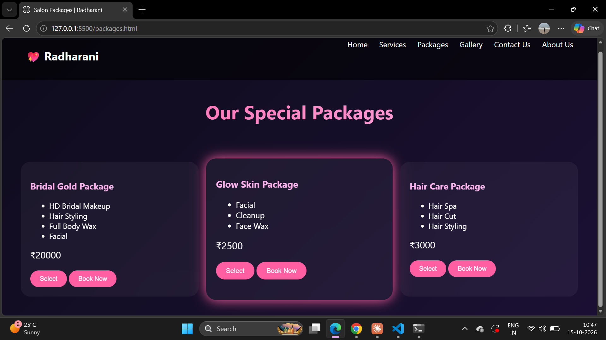
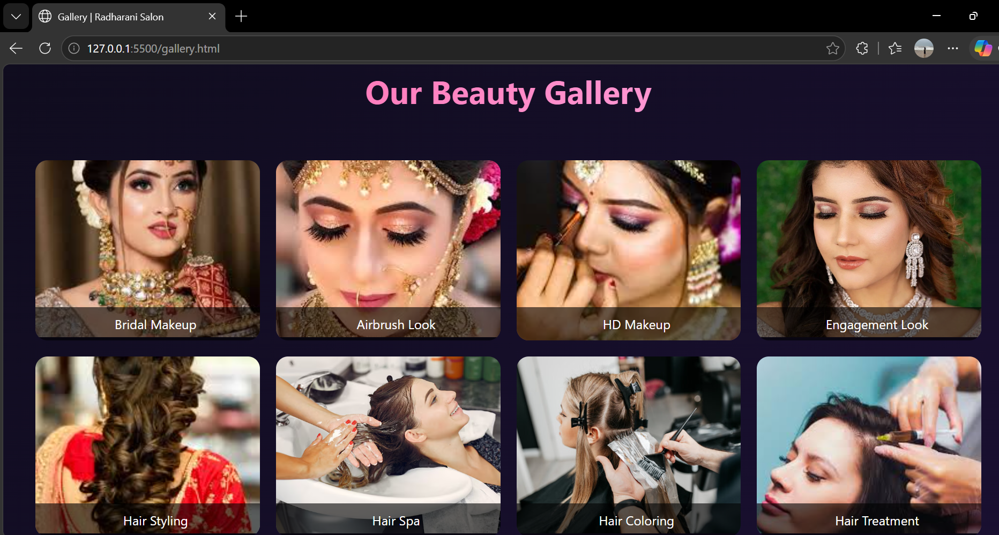
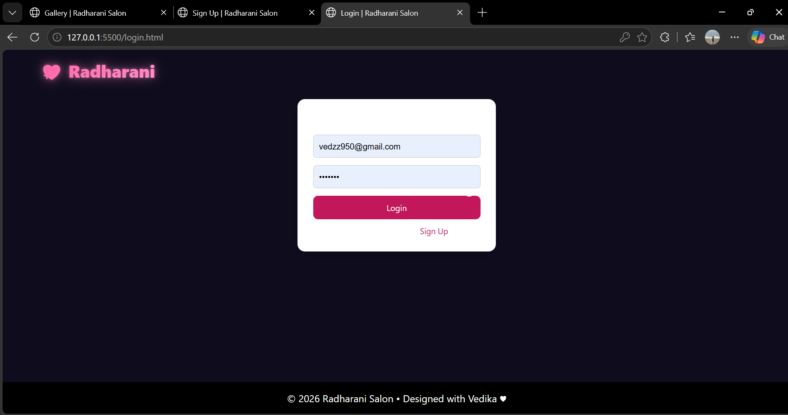
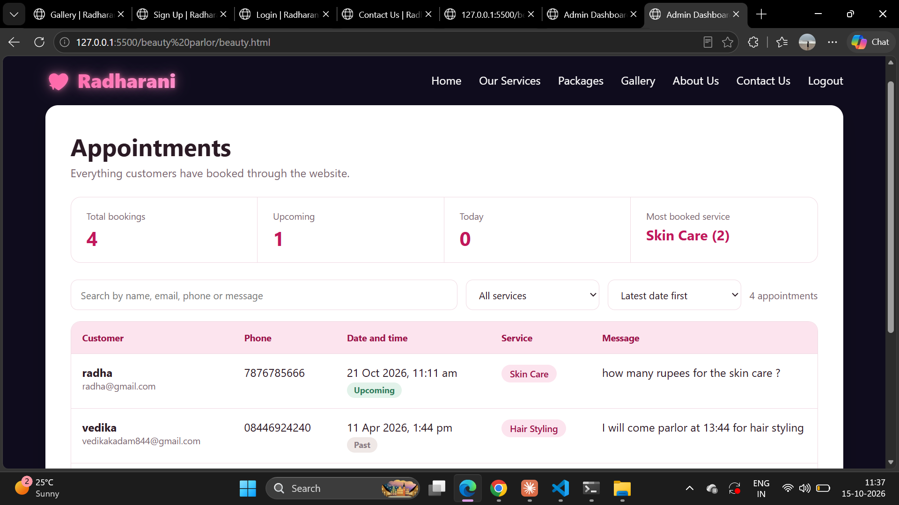
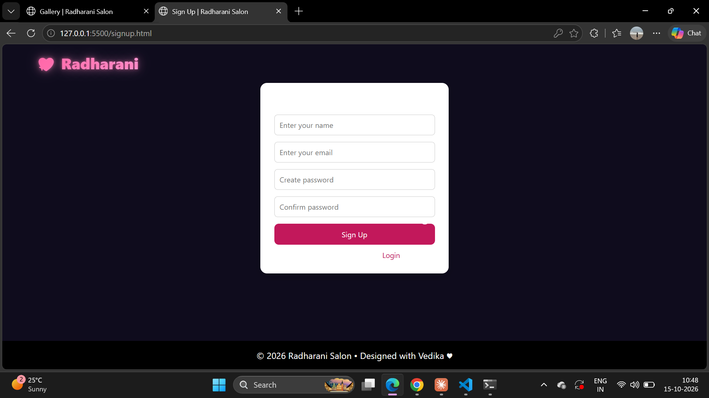

# Radharani Beauty Hub

A full stack beauty parlor website where customers can browse services and packages, sign up, log in and make payments, with an admin panel to manage the business.

## Features

- **User authentication:** signup and login
- **Services:** browse all beauty services (hair, facial, waxing, bridal, etc.)
- **Packages:** ready-made beauty packages
- **Payment:** online payment page
- **Gallery:** photos of the salon's work
- **About Us and Contact Us:** salon information and enquiry details
- **Admin panel:** manage the salon's data

## Tech Stack

| Layer | Technology |
|-------|------------|
| Frontend | HTML, CSS, JavaScript |
| Backend | Node.js, Express.js |
| Database | MySQL |
| Python module | Python, FastAPI, Streamlit |

## Project Structure

```
├── beauty.html          # Home page
├── login.html           # Login
├── signup.html          # Signup
├── Services.html        # Services
├── packages.html        # Packages
├── payment.html         # Payment
├── gallery.html         # Gallery
├── AboutUs.html         # About us
├── ContactUs.html       # Contact us
├── admin.html           # Admin panel
├── server.js            # Node.js + Express server
├── main.py              # Python module
├── *.sql                # Database scripts
└── .env.example         # Environment variables template
```

## Setup

1. **Clone the repo**
   ```bash
   git clone https://github.com/kadam806/radharani-beauty-hub.git
   cd radharani-beauty-hub
   ```

2. **Install dependencies**
   ```bash
   npm install
   ```

3. **Set up the database**
   - Create a MySQL database
   - Import the `.sql` files from the repo (for example `users login and signup.sql`)

4. **Configure environment variables**
   - Copy `.env.example` to `.env`
   - Fill in your MySQL details:
   ```
   DB_HOST=localhost
   DB_USER=root
   DB_PASSWORD=your_mysql_password
   DB_NAME=your_database_name
   ```

5. **Run the server**
   ```bash
   node server.js
   ```
   The server runs on `http://localhost:5000` and prints "MySQL Connected" when the database connects.

6. **Open the website**
   Open `beauty.html` in your browser.

## Screenshots

### Home


### Services


### Packages


### Gallery


### Login


### Admin Panel


### Sign up


## Author

**Vedika Kadam**
GitHub: [@kadam806](https://github.com/kadam806)
